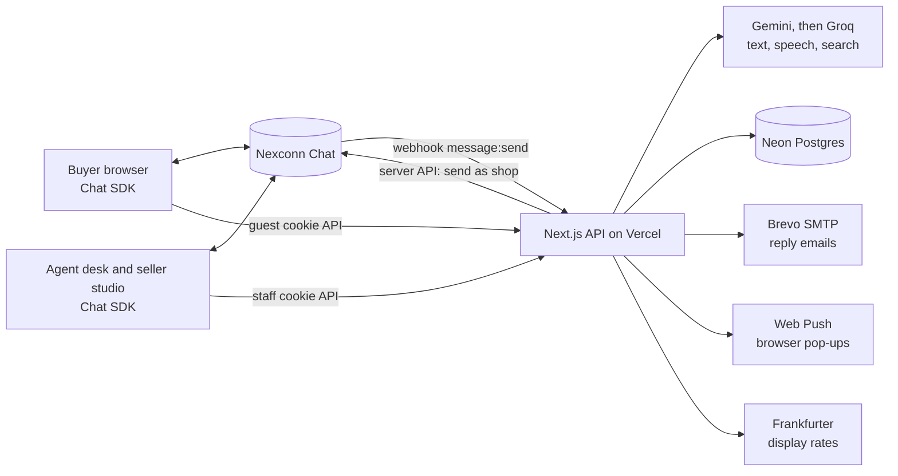

# LinguaDesk

**A multilingual marketplace and support desk for small shops. Customers write in their own language; the shop reads and replies in English. Prices, dates and quantities are checked in code, not trusted to the AI.**

Built for the **Nexconn Build Challenge 2026** (track: Marketplace & Support) with the Nexconn Chat SDK.

- **Live demo:** https://lingua-desk-one.vercel.app
- **Marketplace (buyers):** https://lingua-desk-one.vercel.app/marketplace
- **Demo shop (Lotus Handloom, fictional):** https://lingua-desk-one.vercel.app/chat/lotus-handloom
- **Open a shop:** https://lingua-desk-one.vercel.app/sell
- **Shop owners and agents sign in:** https://lingua-desk-one.vercel.app/login (sign-in details for judges are in the submission PDF)
- **Nexconn App Key:** `e0x9wycferq6q` (public by design; the App Secret is never committed)

## The problem

A small shop that sells online gets questions in languages the owner does not speak, at hours the owner is asleep. Machine translation alone is risky: one wrong digit in a price or delivery time costs a sale or causes a dispute. And the buyer needs more than a chat: a way to find the right shop, order, pay, track and return, all in a language they read.

## The solution

1. A buyer opens the marketplace or a shop link, or scans a QR code. No signup.
2. An AI assistant answers instantly, in the buyer's language, using only facts the shop provided.
3. When a person is needed (orders, complaints, anything the AI does not know), the conversation goes to the shop's queue. Dispatch assigns a team member who speaks the buyer's language, with an English summary and an English translation of every message.
4. The agent writes in English. The buyer receives their own language. Every price, date and quantity is verified in code before a message is sent.
5. The order, the delivery address, payment, tracking, returns and reviews all happen in the same place, with the buyer reading everything in their own language.

## What is in the product

### For buyers (no account)

| Area | What it does |
|---|---|
| Marketplace and search | Browse shops and products. Search in plain words: the AI reads the query into filters, shows how it understood it as chips the buyer can remove, and relaxes the filters when nothing matches. A rules-based parser takes over if the AI is slow |
| Shop and product pages | Photos, colours, sizes, stock, ratings and reviews, response target, opening hours, shipping, policies and FAQs. "Team online" turns to "Away" outside the shop's business hours. Shared links show the shop or product name and picture |
| Language and currency | Header picker with 10 languages and 8 currencies, saved in the browser and available on phones. Prices are converted for display with daily reference rates (Frankfurter); orders are always charged in US dollars and the buyer is told so |
| Chat in their language | The AI answers from the shop's products, FAQs and policies. "Ask the shop owner" hands over at any time. Under each message the buyer sees what the shop reads in English, and can report a wrong translation to the shop |
| Voice | Record a voice message (Groq Whisper, then Gemini as a fallback); the sender reviews and edits the transcript before it is sent. A Listen button reads any message aloud with the device voice when one exists for that language, otherwise with Gemini speech (cached). Audio is not stored |
| Ordering | **Buy now** on a product page starts an order without waiting for the shop: price and shipping come from the shop's own catalogue and rules, and the buyer confirms it in the chat. Or the agent proposes an order card built from the catalog. The buyer confirms it in their language, enters a delivery address, and pays through the shop's own payment link or instructions (money goes straight to the shop; LinguaDesk never handles payments). Stock is reserved when the buyer confirms and returned if the order is cancelled. The order page shows a timeline from proposed to delivered, courier and tracking |
| After the sale | Cancel while an order is proposed or confirmed. Request a return with a photo within 30 days of delivery. Leave one verified review (rating and text) per delivered order |
| Stay informed | Unread badges in the header and conversation list. When the buyer is away from the chat, a browser pop-up (Web Push) and an optional email (confirmed by link first) announce a reply, an order update or a return decision. A link continues the same conversation on another device |
| Privacy | `/privacy` lets a buyer download everything stored about them as one file, or delete it (type DELETE). Shops keep an order record (items, total, status) without the buyer's name, address or messages |

### For sellers (seller studio at `/seller`)

| Area | What it does |
|---|---|
| Sign-up | Four steps. The shop gets its own chat identity on Nexconn, the owner passcode is stored hashed, and a one-time recovery code resets a lost passcode |
| Inventory | Products with price, stock, colours, sizes and an uploaded photo (resized in the browser, stored in Postgres, content-checked on upload) |
| Knowledge and AI | FAQs, an AI glossary of terms that must always translate the same way, a reply tone, and "Learn from chats", which suggests new FAQs from conversations where the AI had to hand over |
| Settings | Shipping, policies, reply target, weekly business hours with a time zone and away message (the AI and the reply timer know when the shop is closed), the assistant's name, payment link and payment instructions |
| Orders and returns | Move orders through packed, shipped and delivered with courier and tracking; see the delivery address; mark an order paid. Approve or reject returns with a note and see the buyer's photo |
| Team | Invite codes (up to 20 open), agents with languages, skills (labels) and a maximum number of concurrent chats. Removing an agent returns their conversations to the queue and ends their session immediately |
| Performance | Share resolved by the AI, response times, ratings, revenue and order funnel, languages and topics |

### For agents (desk at `/agent`)

| Area | What it does |
|---|---|
| Inbox | Queue, assigned and resolved conversations with a response timer (green, amber, then "Overdue"). Every message has its English translation. Claim, transfer, escalate, resolve, reopen or hand back to the AI |
| Replying | Write in English and preview the buyer-language version and its back-translation before sending. One click drafts a suggested reply; canned replies and internal notes are built in. Voice input is available |
| Orders from chat | Pick products from the catalog and send an order card; totals are computed from the catalog in code |
| Dispatch board | Auto-assigns by language and current load (never above a person's maximum concurrent chats), or assign by hand. The roster shows Offline, Available or Away per person |
| Customers and analytics | Customer directory with orders and spend, and per-agent performance |
| Alerts | A notification bell for new handoffs, orders, cancellations, returns, reviews and reported translations; desktop push for the team |

## Safety design

- **The AI never sets a price.** Product prices live in the shop's catalog and order totals are computed in code. The AI only translates words.
- **Answers are grounded.** The AI may use only the shop's products, FAQs, policies, hours and glossary. Anything else triggers a handoff to a person.
- **Numbers are verified deterministically** (`lib/number-check.ts`) across Latin, Devanagari, Tamil, Kannada, Arabic-Indic and full-width digits. English number words are accepted as the same number ("two" and "2", "two hundred and fifty" and "250", "2 lakh" and "200,000"), so an AI answer cannot introduce a number that is not in the shop data or the buyer's message. The agent's reply preview shows which numbers were kept, or which were lost or added.
- **Stock cannot be sold twice.** Confirming an order takes its stock in one database statement that either reserves every line or none (`lib/v2/inventory.ts`); a cancelled order gives it back once.
- **A buyer message is never lost.** It is stored before any slow work, duplicate deliveries are ignored per message, the AI call has a deadline, and any failure hands the conversation to the team with a holding reply.
- **Orders, complaints and price negotiation** always go to a person.
- **Untrusted input.** Buyer text is passed to the AI as data; instructions inside it are ignored.
- **Graceful degradation.** Text AI tries Gemini 3.5 Flash-Lite, then 3.1 Flash-Lite, then 3.6 Flash, then Groq `gpt-oss-120b` and `gpt-oss-20b`. If every provider fails the buyer gets a polite holding message and the shop is alerted.
- **Accounts and sessions.** Rate-limited sign-in (per address and per account, failing closed if the counter cannot be read), hashed passcodes, signed httpOnly session cookies that end when the passcode changes, signed webhooks, security headers. Photos sent in chats or with returns are private to the people involved; only product photos are public. The retired single-shop endpoints answer 404 unless `ENABLE_LEGACY_SINGLE_SHOP=1`.
- **Fair use.** Sign-up, guest sessions, AI calls, read-aloud, exports and deletions are all rate-limited per visitor, so the free tiers cannot be drained by one person.

## How Nexconn is used

| Nexconn feature | Where |
|---|---|
| **Chat SDK for Web** (`@nexconn/chat`, `@nexconn/engine`), Singapore data center | `lib/nexconn-client.ts`: buyers and shop staff connect with an access token, receive messages in real time, load history and show connection status |
| **A chat identity per shop** | At sign-up each shop is registered as a Nexconn user (`app/api/auth/signup`), and every conversation is a one-to-one chat between a guest buyer and the shop |
| **Server API: access tokens** | `app/api/buyer/session`, `app/api/desk/token`: the server picks buyer IDs and issues tokens, so a browser can never request a token as a shop |
| **Server API: send message** | `lib/nexconn-server.ts`: AI replies, translated agent replies, order cards and status notices are sent server-side as the shop, with primary and backup API hosts and request signing |
| **Message metadata** | Marks AI-written messages, and carries the order card and the order confirmation inside normal messages, so no custom message type is needed |
| **Webhooks** (`message:send`) | `app/api/webhooks/nexconn`: signature verified, size and shape checked, acknowledged within the 5-second limit, processed in the background and de-duplicated per message. Typing indicators use `sendTypingStatus` and `onTypingStatusChanged` (written against the SDK's typings; not exercised against the live service) |

## Architecture



## Tech stack

Next.js 16 (App Router, Cache Components), React 19, TypeScript, Tailwind CSS 4, Nexconn Chat SDK, Neon Postgres, Google Gemini and Groq, Web Push (VAPID) and Brevo SMTP for notifications, Frankfurter for reference exchange rates, Vercel. **Every service runs on a free tier; nothing here costs money.**

## Run it locally

Requirements: Node.js 20+, a free Nexconn account, a free Neon database, a free Gemini API key. A Groq key (voice and faster search), Brevo SMTP details (reply emails) and a VAPID key pair (browser pop-ups) are optional; the features that need them switch off when they are missing.

```bash
npm install
cp .env.example .env.local          # then fill in the values (see the comments inside)
# create the tables, in this order; every script is safe to re-run
node --env-file=.env.local scripts/migrate.mjs       # original single-shop demo tables
node --env-file=.env.local scripts/migrate-v2.mjs    # marketplace: shops, staff, buyers, threads, orders
node --env-file=.env.local scripts/migrate-v3.mjs    # assistant name, shop notifications
node --env-file=.env.local scripts/migrate-v4.mjs    # images, recovery code, hours, returns, reviews, push, device links, exchange rates
node --env-file=.env.local scripts/migrate-v5-buyer-email.mjs
node --env-file=.env.local scripts/migrate-v6-checkout.mjs
node --env-file=.env.local scripts/migrate-v7-translation-reports.mjs
node --env-file=.env.local scripts/migrate-v8-tts-cache.mjs
node --env-file=.env.local scripts/migrate-v9-unread.mjs
node --env-file=.env.local scripts/migrate-v10-privacy.mjs
npm run dev
node --env-file=.env.local scripts/seed-demo.mjs     # optional: four demo shops, passcodes printed once
```

Open http://localhost:3000/marketplace for buyers, http://localhost:3000/sell to open a shop and http://localhost:3000/login for shop owners and agents.

The AI is driven by a Nexconn webhook, which needs a public URL. In the Nexconn Console, add a webhook for the `message:send` event pointing to `https://<your-host>/api/webhooks/nexconn` (deploy to Vercel, or use a tunnel while developing).

Useful scripts:

- `npm run lint`, `npm run build`, `npm test` (unit tests, see Quality checks)
- `scripts/seed-demo.mjs` creates four demo shops through the public sign-up and desk APIs, as a real seller would.
- `scripts/seed-lotus.mjs` copies the original Lotus Handloom demo into the marketplace as a normal shop (`--dry` previews it).
- `scripts/reset-demo.mjs --yes` clears the conversations, messages and orders of the original single-shop demo only. It does not touch the marketplace tables.

## Project layout

```
app/
  (platform)/(customer)/     buyer pages: home, marketplace, shop and product pages, chat, orders, profile, privacy, sign-in, sell
  (platform)/seller/         seller studio: overview, inventory, knowledge, glossary, orders, returns, team, settings, performance
  (platform)/agent/          agent desk: inbox, dispatch, customers, analytics
  api/buyer/                 guest APIs: session, threads, orders, reviews, returns, notifications, read-aloud, data export and deletion
  api/desk/                  staff APIs: threads, replies, orders, returns, products, team, settings, analytics, notifications
  api/public/                public marketplace data, search and exchange rates
  api/auth/                  sign-up, sign-in, recovery
  api/webhooks/nexconn/      Nexconn webhook receiver
  api/voice/, api/assets/    speech to text, image upload and private image delivery
  robots.ts, sitemap.ts, not-found.tsx
  chat/, owner/              the original single-shop demo (its URLs now redirect into the marketplace)
components/platform/         screens grouped by area: chat, orders, seller, agent, public, privacy, voice, auth, growth
lib/
  v2/                        marketplace server code: bot, buyer and desk APIs, dispatch, hours, delivery, alerts, push, search, speech
  nexconn-client.ts          browser SDK wrapper
  nexconn-server.ts          server API client (signing, failover, send, webhook verification)
  gemini.ts, groq.ts         AI providers and fallback chain
  number-check.ts            deterministic number verification
  catalog.ts                 order pricing and the order card format
  rate-limit.ts              per-visitor limits kept in Postgres
proxy.ts                     permanent redirects for retired shop URLs (see Renaming a shop)
tests/                       unit tests (Node's built-in runner) and the loader that lets them import the app's TypeScript
scripts/                     migrations, seeds and the original demo reset
```

## Try it as a judge (5 minutes)

1. Open the **marketplace**, search in plain words (for example "handloom saree") and open **Lotus Handloom**. Switch the language and currency in the header.
2. Press **Start a conversation** on the shop page (or open `/chat/lotus-handloom`) and write in any language, for example `क्या टोट बैग की कीमत बता सकते हैं?`. Use the Listen button on a reply.
3. Ask something the shop info does not cover (`Do you have blue scarves in stock?`). The AI hands over and the conversation enters the shop's queue.
4. In another window, sign in at `/login` with the details in the submission PDF and open the **agent desk**. Read the English translation, click **Suggest a reply**, edit it and send. The buyer receives it in their language.
5. Send an **order card**. As the buyer, confirm it with a delivery address, then as the shop move the order to shipped and delivered. After delivery the buyer can leave a review or request a return.
6. Open **Performance** in the seller studio, and `/privacy` as a buyer to see the data download and deletion controls.

## Quality checks

Each feature was verified end to end during development: type-check, lint and a production build, plus scripted API checks (several hundred in total) and browser passes for the screens, run against the real database and Nexconn. Those scripts were temporary.

`npm test` runs a committed suite with Node's built-in test runner (needs Node 22.7 or newer, unlike the app itself). The suite runs the app's real route handlers and its real SQL against an in-memory Postgres (PGlite, a dev-only dependency) built from the production migration scripts, so it needs no network and cannot reach a real database. It covers the slug aliases and the redirect proxy in every state of a rename, staff sign-in and recovery, sign-up and settings name rules, the shop lookup used for new chats, the sitemap, the SEO tags, the number guard and translation grounding, webhook reliability (duplicates, AI failure, hand-over), authentication throttling and tenant isolation, order and stock behaviour, marketplace visibility and country names, and the exact SQL printed below. It does not cover the rest of the app, and it does not exercise Neon's own driver or Nexconn. Stock reservation was tested one request at a time, not with truly simultaneous connections.

## Renaming a shop (URL aliases)

Shops keep their slug when their display name changes. When a slug itself has to change, add the pair to `SLUG_ALIASES` in `lib/v2/slug-aliases.ts` and its URL shapes to the matcher in `proxy.ts` (a test fails if the two disagree). Current pair: `barbara` and `homely-kitchen` (display name Homely Kitchen).

**Status: the application code is ready; the shop record has not been renamed.** The two slugs are two addresses for one shop, and whichever one the database holds is the real one. Until the statement below is run, `/s/barbara` serves the shop and `/s/homely-kitchen` redirects to it.

What the code does, in every state of the database (`proxy.ts` runs only on `/s/<slug>`, `/s/<slug>/p/<id>` and `/chat/<slug>` for these two slugs, and asks the database which of the two exists):

| The database holds | Requests for the other slug | Requests for the slug it holds |
|---|---|---|
| only `homely-kitchen` | HTTP 308 to the same path under `homely-kitchen` | served |
| only `barbara` | HTTP 308 to the same path under `barbara` | served |
| both (two different shops) | not redirected; a `SLUG ALIAS CONFLICT` warning is written to the server log | served, each by its own shop |
| neither | not redirected: the normal not-found page | not found |
| the lookup fails | not redirected; the failure is logged | served as usual |

- The product id and the whole query string are kept. Other shops, look-alikes (`/s/barbara-2`), other capitalisations (`/s/Barbara`) and other paths are never touched, and never cost a database query.
- The 308 carries `Cache-Control: no-store`, so a browser does not remember it and a rename or its rollback takes effect on the next visit. Every request for the two slugs' URLs, including the canonical ones, costs one small indexed query. That check is cut off after 2 seconds: if the database is slow or down, the request simply continues to the normal page (and the failure is logged) instead of waiting.
- Sign-in and recovery accept the shop name or either slug, but the other slug of the pair only counts while the typed slug is not a shop of its own, so an alias can never lead into a different shop. Staff sessions hold only the staff id, so they stay valid.
- A new chat request that carries either slug is resolved to the shop that exists (`sellerBySlug`); a shop that really owns the slug always wins.
- A new sign-up, or another shop renaming itself in Settings, cannot use a name that matches another shop's name or either slug of the pair. Only the shop that holds one of the two slugs may use either name. This also closes an older gap: sign-up used to allow two shops with the same display name.
- The sitemap, share link, QR code, notification links, privacy export and the canonical and share-preview tags are all built from the slug stored on the shop record, so they follow the record in either direction.

Order of steps (nothing here is done by the code):

1. Deploy this code. Nothing changes for visitors except that `/s/homely-kitchen` now redirects to `/s/barbara`.
2. If the shop owner already changed the display name in Settings, the statement below matches nothing (its guard is `shop_name = 'barbara'`); adjust the guard to the current name first. Nothing is changed if the guard does not match.
3. Run the statement below once against the production database, after approval.
4. Check with `curl -sI`: `/s/barbara`, `/s/barbara/p/<an id>` and `/chat/barbara?x=1` return `308` with the new `location`; `/s/homely-kitchen` returns `200`; `/sitemap.xml` lists `/s/homely-kitchen` and not `/s/barbara`; the page title is `Homely Kitchen · LinguaDesk`; the owner can sign in with `Homely Kitchen` and with `barbara`; the server log shows no `SLUG ALIAS CONFLICT`.

```sql
UPDATE sellers
SET slug = 'homely-kitchen', shop_name = 'Homely Kitchen',
    tagline = 'Fresh homemade food, breakfast and evening snacks.', agent_name = 'Homely Kitchen Assistant'
WHERE slug = 'barbara' AND shop_name = 'barbara'
RETURNING slug, shop_name, tagline, agent_name; -- expect exactly 1 row
```

It changes four columns of one row. The seller id, owner and staff records, passcodes, the Nexconn user id and every related row (they all point at the seller id) are not touched. The unique index on `slug` makes it fail, changing nothing, if `homely-kitchen` is already taken.

Rollback (no code change or redeploy is needed: the proxy follows the database in both directions, so as soon as `barbara` exists again, `/s/homely-kitchen` redirects to it, including links that were already shared):

```sql
UPDATE sellers
SET slug = 'barbara', shop_name = 'barbara', tagline = 'We sell home food', agent_name = ''
WHERE slug = 'homely-kitchen' AND shop_name = 'Homely Kitchen'
RETURNING slug, shop_name, tagline, agent_name; -- expect exactly 1 row
```

After a rollback the new links keep working, because they redirect to the old address. Check with `curl -sI`: `/s/homely-kitchen`, `/s/homely-kitchen/p/<an id>` and `/chat/homely-kitchen?x=1` return `308` with the old `location` and the query kept; `/s/barbara` returns `200`; `/sitemap.xml` lists `/s/barbara` and not `/s/homely-kitchen`; the owner can sign in with `barbara` and with `Homely Kitchen`; the server log shows no `SLUG ALIAS CONFLICT`.

If the log shows `SLUG ALIAS CONFLICT`, two different shops hold the two slugs, which the pair is never meant to allow, so the proxy redirects nothing in either direction. Find them with `SELECT id, slug, shop_name, owner_name, created_at FROM sellers WHERE slug IN ('barbara', 'homely-kitchen');`, decide which one is the real shop, and rename or remove the other one. Do not delete a shop that has conversations or orders: every related row is deleted with it.

Caching and deployment notes:

- Shop pages and the sitemap are rendered per request, so the new name and address appear immediately. Search engines treat a 308 as permanent and will move their index over time; link previews already cached by chat apps and social sites keep the old title until they refresh.
- `proxy.ts` makes one small indexed query (`SELECT slug FROM sellers WHERE slug = ANY(...)`) on each request for one of the six URL shapes above, and on no other request.
- The shop's chat identity name in Nexconn is sent when a desk token is issued. Whether Nexconn updates a stored name for an existing user is not verified; the app never shows that name.
- `npm run build` prints `shop info read failed ... This occurred at route "/api/shop"`. It is harmless and was there before the rename work: Next starts the old single-shop route during the build to see whether it can be static, notices the database call, abandons the attempt and marks the route dynamic. No query is sent and the build still succeeds, with or without a reachable database.

## Honest limits

- The demo shops are fictional. LinguaDesk never touches payments: the buyer pays the seller through the seller's own link or instructions, and the seller marks the order paid.
- Currency conversion is for display only. Orders are charged in US dollars.
- Free tiers have limits (Gemini daily quotas, Groq per-minute tokens, Brevo 300 emails a day). The fallback chain and the rate limits exist for this reason, and messages sent to the AI providers fall under their free-tier terms.
- The language picker offers 10 languages; the AI answers in whatever language the buyer writes. The original demo was tested end to end in 12 languages (English, Spanish, Portuguese, French, Russian, Hindi, Tamil, Kannada, Arabic, Chinese, Japanese, Korean). Voice accuracy for Arabic and Indian languages was not checked with native speakers.
- The first time a message is read aloud with Gemini speech takes several seconds; later plays are instant because the audio is cached.
- Browser pop-ups need the buyer's permission and a secure (https) address. Email replies need the buyer to confirm their address.
- Buyers are guests identified by a cookie. Clearing site data starts a new buyer unless they used the continue-on-another-device link first.
- Not built yet: stock alerts, report and block a buyer, installable app (PWA), restocking on returns, and a script-src content security policy (it needs per-request nonces).
- Optional setting `MARKETPLACE_UNLISTED_SLUGS` (comma-separated shop slugs) keeps test shops out of the directory, search and sitemap without deleting them.

## License

Source is public for the Nexconn Build Challenge 2026 submission.
